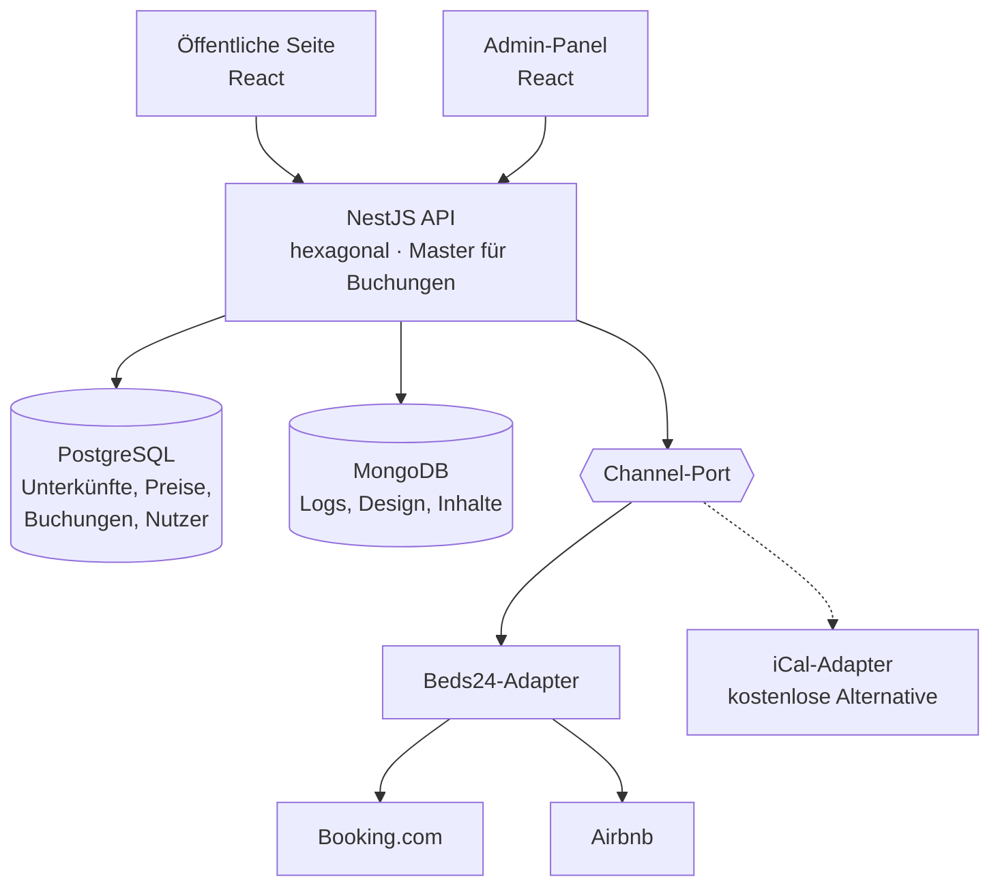

# Haus Anna Bodenmais – Webseite

Neubau von [hausanna-bodenmais.de](https://hausanna-bodenmais.de/) (bisher WordPress + Divi + MotoPress Hotel Booking).

- **Öffentlicher Teil:** Design 1:1 wie die bisherige Seite
- **Admin-Panel:** neu (Dashboard, Unterkünfte, Kalender, Kanäle, Benutzer, Design)
- **Buchungen:** Unser Backend ist die **Single Source of Truth**. Booking.com und Airbnb werden über **Beds24** in Echtzeit synchronisiert.

---

## Architektur

| Teil | Technik |
|---|---|
| Frontend (Webseite + Admin) | TypeScript, React |
| Backend | TypeScript, NestJS, hexagonale Architektur (Ports & Adapter) |
| Datenbanken | PostgreSQL (Buchungen, Unterkünfte, Nutzer), MongoDB (Logs, Design, Inhalte) |
| Kanal-Anbindung | Beds24 API + Webhooks → Booking.com & Airbnb |
| Server | IONOS VPS, AlmaLinux 10, Nginx, Let's Encrypt |

### Buchungsablauf

| Wo bucht der Gast? | Was passiert |
|---|---|
| **Webseite** | Backend speichert die Buchung → meldet sie an Beds24 → Booking.com und Airbnb sind in Sekunden gesperrt → Gast bekommt sofort die Bestätigung |
| **Booking.com / Airbnb** | Beds24 sperrt den anderen Kanal sofort → Webhook an unser Backend → Buchung erscheint im Kalender |

> ⚠️ **Regel:** Preise, Sperren und Unterkünfte werden **nur im Admin-Panel** geändert, nie direkt in Beds24, Booking.com oder Airbnb. Sonst gibt es zwei „Wahrheiten“.

---

## Benötigte Anbieter & Kosten

| Anbieter | Wofür | Kosten / Monat |
|---|---|---|
| **IONOS VPS** | Server (AlmaLinux 10). Gewählt: **VPS M+ (4 GB RAM)**. Weniger RAM nicht empfohlen, da Postgres + MongoDB + Node laufen | ca. **4 €** ¹ |
| **Beds24** | Channel-Manager: Echtzeit-Sync mit Booking.com und Airbnb | ca. **11 €** ² |
| IONOS Domain + E-Mail | `hausanna-bodenmais.de`, `info@…`, Versand der Buchungsmails (SMTP) | bestehender Vertrag ³ |
| Let's Encrypt | SSL-Zertifikat | 0 € |
| GitHub | Code, CI | 0 € |
| **Summe (laufend)** | | **ca. 15 €** |

**Nicht in der Summe:** Provisionen der Portale pro Buchung, die bei der Vermieterin anfallen (Booking.com üblicherweise ca. 15 %, Airbnb je nach Gebührenmodell). Buchungen über die eigene Webseite sind **provisionsfrei**.

¹ IONOS gibt „ab“-Preise oft für 24 Monate Laufzeit an. Preis beim Abschluss prüfen.
² Schätzung für 5 Wohnungen und 2 Portale: Grundgebühr ca. 8,40 € + ca. 0,55 € je weitere Wohnung und je Portal. Weitere API-Aufrufe und SMS werden extra berechnet. Aktuelle Preise: [beds24.com](https://beds24.com).
³ Läuft schon für die bisherige Seite. Prüfen, ob er nach dem Umzug weiterläuft (WordPress-Hosting kann gekündigt werden).

---

## Neue Unterkunft hinzufügen

**Zusätzliche Kosten:** ca. **+0,55 €/Monat** bei Beds24 (Schätzung). Der Server bleibt gleich.

| # | Wo | Was |
|---|---|---|
| 1 | **Admin-Panel → Unterkünfte → Neu** | Name, Größe, max. Personen, Ausstattung, Beschreibung, Fotos, Preise/Saisons, Mindestaufenthalt anlegen. Erscheint danach automatisch auf der Webseite und im Menü (erst auf „Veröffentlicht“ stellen, wenn die Schritte 2–5 erledigt sind) |
| 2 | **Booking.com Extranet** | Neuen Zimmertyp bzw. neue Unterkunft anlegen |
| 3 | **Airbnb** | Neues Inserat anlegen |
| 4 | **Beds24** | Neue Unterkunft (Room) anlegen und mit dem Booking.com-Zimmer und dem Airbnb-Inserat verknüpfen (Mapping) |
| 5 | **Admin-Panel → Kanäle** | Beds24-Room-ID bei der neuen Unterkunft eintragen, Kanäle aktivieren |
| 6 | **Test** | Im Admin einen Testzeitraum sperren und prüfen, ob er bei Booking.com und Airbnb gesperrt ist. Danach wieder freigeben |
| 7 | **Admin-Panel → Unterkünfte** | Auf „Veröffentlicht“ stellen |

> Unterkunft **entfernen:** im Admin auf „Archiviert“ stellen (bestehende Buchungen bleiben erhalten), danach bei Beds24, Booking.com und Airbnb deaktivieren.

---

## Umsetzungsplan

| Phase | Inhalt | Status |
|---|---|---|
| 0 | Setup: Monorepo (pnpm), Docker Compose (Postgres + MongoDB), Linting, CI | ⏳ |
| 1 | Backend-Kern: Unterkünfte, Preise/Saisons, Verfügbarkeit, Buchungen, Login/Rollen | ⏳ |
| 2 | Öffentliche Seite 1:1 + Buchungsformular | ⏳ |
| 3 | Admin: Dashboard (Nachrichten, Infos, Fehler), Unterkünfte, Kalender, Benutzer | ⏳ |
| 4 | Channel-Port + Beds24-Adapter (Booking.com, Airbnb), iCal-Adapter als Fallback | ⏳ |
| 5 | Design-Seite: Farben, Fonts, Logo, Bilder, Texte | ⏳ |
| 6 | Go-Live: Daten aus WordPress/MotoPress migrieren, Server einrichten, DNS umstellen | ⏳ |

Details zur Analyse der bisherigen Seite: [docs/analyse-bestehende-seite.md](docs/analyse-bestehende-seite.md)
Getroffene Entscheidungen: [docs/entscheidungen.md](docs/entscheidungen.md)
