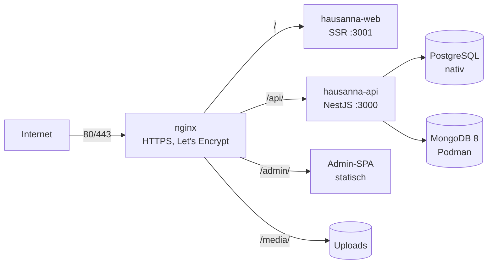

# Deployment auf AlmaLinux 10 (IONOS VPS M+)

## Überblick



| Teil           | Wie läuft es                                  | Wo                                 |
| -------------- | --------------------------------------------- | ---------------------------------- |
| Webseite (SSR) | systemd `hausanna-web`                        | `127.0.0.1:3001`                   |
| API            | systemd `hausanna-api`                        | `127.0.0.1:3000`                   |
| Admin-Panel    | statische Dateien über nginx                  | `/opt/hausanna/apps/admin/dist`    |
| Bilder/Uploads | nginx `/media/`                               | `/var/lib/hausanna/uploads`        |
| PostgreSQL     | AlmaLinux-Paket                               | nur localhost                      |
| MongoDB 8      | Podman-Container (Quadlet) `hausanna-mongodb` | nur `127.0.0.1:27017`              |
| Konfiguration  | `/etc/hausanna/api.env`                       | wird nie automatisch überschrieben |
| Backups        | systemd-Timer, täglich 03:30, 14 Tage         | `/var/backups/hausanna`            |

**Warum MongoDB in Podman?** MongoDB bietet für RHEL/AlmaLinux 10 laut Doku nur die neue Version 9.0 an. Lokal entwickeln wir mit MongoDB 8 (`docker-compose.yml`). Mit dem Container läuft auf dem Server **genau dieselbe Version**, und das System bleibt sauber. Podman ist bei AlmaLinux schon dabei.

**Node.js:** AlmaLinux 10 liefert Node.js 22 über `dnf install nodejs` mit. Ist die Version älter als 22.12, installiert `install.sh` automatisch das offizielle Node.js 22 LTS nach `/usr/local`.

---

## 1. Erstinstallation

| #   | Schritt                                                                                                                        |
| --- | ------------------------------------------------------------------------------------------------------------------------------ |
| 1   | VPS **M+** bei IONOS mit **AlmaLinux 10** bestellen, Root-Passwort/SSH-Key notieren                                            |
| 2   | Einloggen: `ssh root@<SERVER-IP>`                                                                                              |
| 3   | Skript holen: `dnf -y install git && git clone https://github.com/ReneSchneider98/hausanna-bodenmais.git /root/hausanna-setup` |
| 4   | Optional E-Mail-Adressen anpassen: `export ADMIN_EMAIL=… LE_EMAIL=…`                                                           |
| 5   | Starten: `bash /root/hausanna-setup/deploy/almalinux/install.sh` (dauert ca. 10–15 Min.)                                       |
| 6   | **Admin-Passwort** aus der Ausgabe notieren (wird nur einmal angezeigt)                                                        |
| 7   | In `/etc/hausanna/api.env` eintragen: `SMTP_PASSWORD`, `BEDS24_REFRESH_TOKEN` → `systemctl restart hausanna-api`               |
| 8   | Testen über die IP: `http://<SERVER-IP>/` und `http://<SERVER-IP>/admin/`                                                      |
| 9   | Daten aus WordPress importieren (siehe README, Abschnitt Import)                                                               |

> Das Skript darf beliebig oft laufen. Es überschreibt keine Passwörter oder Konfiguration.

---

## 2. Domain umstellen (von IONOS-WordPress auf den VPS)

| #   | Schritt                                                                                       |
| --- | --------------------------------------------------------------------------------------------- |
| 1   | IONOS → **Domains & SSL** → `hausanna-bodenmais.de` → **DNS**                                 |
| 2   | **A-Record** `@` → IP des VPS                                                                 |
| 3   | **A-Record** `www` → IP des VPS (oder CNAME `www` → `hausanna-bodenmais.de`)                  |
| 4   | AAAA-Records (IPv6) des alten Hostings löschen oder auf die IPv6 des VPS setzen               |
| 5   | ⚠️ **MX-Records und alles rund um E-Mail NICHT anfassen**, sonst geht `info@` kaputt          |
| 6   | Warten, bis `dig +short hausanna-bodenmais.de` die VPS-IP zeigt (Minuten bis wenige Stunden)  |
| 7   | HTTPS einrichten: `bash /opt/hausanna/deploy/almalinux/install.sh --tls-only`                 |
| 8   | Erst wenn alles läuft: WordPress-Hosting bei IONOS kündigen (Domain + E-Mail-Paket behalten!) |

---

## 3. Updates

```bash
bash /opt/hausanna/deploy/almalinux/update.sh            # neuester Stand von main
bash /opt/hausanna/deploy/almalinux/update.sh <commit>   # bestimmter Stand / Rollback
```

Das Skript holt den Code, baut ihn, startet die Dienste neu und prüft `/api/health`. Wenn etwas schiefgeht, zeigt es den Befehl für den **Rollback** an. Datenbank-Migrationen führt die API beim Start selbst aus.

System-Updates: `dnf -y upgrade` (danach ggf. `reboot`).

---

## 4. Backups & Wiederherstellung

| Was                                         | Datei im Backup-Ordner        |
| ------------------------------------------- | ----------------------------- |
| PostgreSQL (Buchungen, Unterkünfte, Nutzer) | `postgres-hausanna.dump`      |
| MongoDB (Design, Inhalte, Logs)             | `mongodb-hausanna.archive.gz` |
| Bilder                                      | `uploads.tar.gz`              |

```bash
hausanna-backup                         # Backup sofort ausführen
ls /var/backups/hausanna                # vorhandene Backups
systemctl list-timers hausanna-backup   # nächster Lauf
```

> ⚠️ Die Backups liegen auf demselben Server. Kopiere sie regelmäßig weg, z. B. mit `scp -r root@<IP>:/var/backups/hausanna ./` oder in den IONOS-Backup-Speicher.

**Wiederherstellen** (Beispiel-Ordner `2026-11-01_0330`):

```bash
B=/var/backups/hausanna/2026-11-01_0330
systemctl stop hausanna-api hausanna-web

# PostgreSQL
runuser -u postgres -- pg_restore --clean --if-exists --dbname=hausanna "$B/postgres-hausanna.dump"

# MongoDB
podman exec -i hausanna-mongodb sh -c 'mongorestore --drop --username "$MONGO_INITDB_ROOT_USERNAME" --password "$MONGO_INITDB_ROOT_PASSWORD" --authenticationDatabase admin --archive --gzip' < "$B/mongodb-hausanna.archive.gz"

# Uploads
tar -xzf "$B/uploads.tar.gz" -C /var/lib/hausanna
chown -R hausanna:hausanna /var/lib/hausanna/uploads
restorecon -R /var/lib/hausanna/uploads

systemctl start hausanna-api hausanna-web
```

---

## 5. Fehlersuche

| Problem                          | Befehl                                                                                                          |
| -------------------------------- | --------------------------------------------------------------------------------------------------------------- |
| Läuft alles?                     | `systemctl status hausanna-api hausanna-web hausanna-mongodb nginx postgresql`                                  |
| API-Logs                         | `journalctl -u hausanna-api -n 100 -f`                                                                          |
| Webseiten-Logs                   | `journalctl -u hausanna-web -n 100 -f`                                                                          |
| MongoDB-Logs                     | `journalctl -u hausanna-mongodb -n 100`                                                                         |
| nginx-Fehler                     | `tail -f /var/log/nginx/hausanna.error.log`                                                                     |
| Health-Check                     | `curl http://127.0.0.1:3000/api/health`                                                                         |
| nginx-Konfig prüfen              | `nginx -t`                                                                                                      |
| **502 Bad Gateway**              | Dienst läuft nicht (Logs oben) **oder** SELinux blockiert: `getsebool httpd_can_network_connect` muss `on` sein |
| **403 bei /admin/ oder /media/** | SELinux-Kontext: `restorecon -R /opt/hausanna/apps/admin/dist /var/lib/hausanna/uploads`                        |
| SELinux-Meldungen ansehen        | `ausearch -m avc -ts recent`                                                                                    |
| Zertifikat erneuern testen       | `certbot renew --dry-run`                                                                                       |

### SELinux (bleibt eingeschaltet!)

| Einstellung                                               | Warum                                       |
| --------------------------------------------------------- | ------------------------------------------- |
| `httpd_can_network_connect = on`                          | nginx darf an die Node-Dienste weiterleiten |
| `httpd_sys_content_t` auf `apps/admin/dist` und `uploads` | nginx darf die Dateien ausliefern           |

SELinux **nicht** abschalten. Fast jedes Problem lässt sich mit `restorecon` oder einem `setsebool` lösen.

---

## 6. Laufende Kosten

| Posten                                      | €/Monat      |
| ------------------------------------------- | ------------ |
| IONOS VPS M+ (4 GB RAM)                     | ca. 4 €      |
| Beds24 (Booking.com + Airbnb)               | ca. 11 €     |
| Domain + E-Mail (bestehender IONOS-Vertrag) | wie bisher   |
| Let's Encrypt, Podman, PostgreSQL, MongoDB  | 0 €          |
| **Summe**                                   | **ca. 15 €** |
